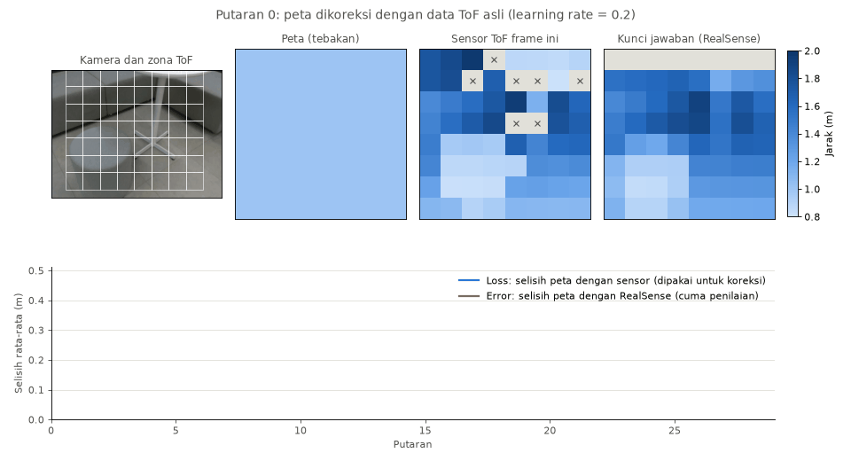

# ToF Learning

Catatan belajar dan kode Python untuk memahami paper [*Multi-Modal Neural Radiance Field for Monocular Dense SLAM with a Light-Weight ToF Sensor*](https://arxiv.org/abs/2308.14383) (ICCV 2023).

Paper ini membangun peta 3D dan melacak posisi kamera hanya dari kamera RGB dan sensor ToF murah beresolusi 8x8 zona.

**Ini bukan implementasi resmi dan bukan sistem SLAM lengkap.** Repo ini berisi latihan kecil untuk memahami cara kerja paper, langkah demi langkah. Proyek resminya ada di [halaman ZJU3DV](https://zju3dv.github.io/tof_slam/).



## Persiapan

Kode ini dites dengan Python 3.12 di Linux.

### 1. Clone repo

```bash
git clone https://github.com/frzdian/tof-learning.git
cd tof-learning
```

### 2. Pasang library

```bash
python3 -m venv tof-venv
source tof-venv/bin/activate
pip install numpy h5py opencv-python matplotlib open3d
```

### 3. Download dataset

Dataset **tidak ada di repo ini** karena terlalu besar, jadi harus diunduh sendiri.

1. Unduh `ZJUL5-SLAM.zip` (sekitar 3,6 GB) dari [Google Drive](https://drive.google.com/file/d/1wfGKT5z02dCqiZWNYlbPWTBjX5nWMacT/view?usp=sharing). Link ini berasal dari [halaman proyek ZJU3DV](https://zju3dv.github.io/tof_slam/).
2. Ekstrak ke folder `dataset/`. Hasil ekstraknya sekitar 19 GB, jadi siapkan ruang kosong yang cukup.

   ```bash
   mkdir -p dataset
   unzip ZJUL5-SLAM.zip -d dataset/
   ```

Struktur foldernya harus seperti ini:

```text
tof-learning/
└── dataset/
    └── ZJUL5-SLAM/
        ├── README.md
        ├── Kitchen/
        │   ├── Raw/                  # satu file .h5 per frame
        │   ├── CameraTrajectory.txt  # pose kamera ground truth
        │   └── mesh.ply              # mesh 3D ground truth
        ├── LivingRoom/
        ├── Office/
        ├── Office2/
        ├── Reception/
        ├── Sofa/
        └── Sofa2/
```

## Menjalankan kode

Jalankan semua perintah dari folder utama repo.

| Script | Isi | Butuh dataset |
|---|---|---|
| `code/task_1_1_show_rgb.py` | Memutar frame RGB sesuai urutan waktu | Ya |
| `code/show_mess.py` | Membuka mesh ground truth dalam 3D | Ya |
| `code/toy_render.py` | Versi mini rendering warna dan jarak (Eq. 3 dan 4) | Tidak |
| `code/simulasi_iterasi.py` | Simulasi koreksi peta dengan angka buatan | Tidak |
| `code/simulasi_iterasi_dataset.py` | Simulasi koreksi peta dengan data ToF asli | Ya |

```bash
python code/task_1_1_show_rgb.py dataset/ZJUL5-SLAM/Kitchen
python code/show_mess.py dataset/ZJUL5-SLAM/Kitchen/mesh.ply
python code/toy_render.py
python code/simulasi_iterasi.py
python code/simulasi_iterasi_dataset.py
```

`simulasi_iterasi_dataset.py` menyimpan hasilnya di folder `output/`.

## Isi dataset

Tiap frame adalah satu file `.h5` di folder `Raw/`, dan nama filenya adalah timestamp.

| Key | Ukuran | Isi |
|---|---|---|
| `rgb` | 480×640×3 | Gambar RGB |
| `hist_data` | 64×2 | Mean dan sigma jarak tiap zona ToF |
| `mask` | 64 | Status zona ToF: valid atau tidak |
| `fr` | 64×4 | Posisi tiap zona di gambar: `y_min, x_min, y_max, x_max` |
| `depth` | 480×640 | Depth RealSense, bukan input SLAM |

Hal yang perlu diperhatikan:

- **Urutan frame:** urutkan berdasarkan nilai timestamp, bukan teks nama file.
- **Sigma:** `hist_data` berisi sigma, jadi kuadratkan dulu sebelum dipakai di Eq. 5.
- **Zona di luar gambar:** baris pertama zona ToF (y = -64 sampai 0) ada di luar gambar RGB.
- **Pose kamera:** cocokkan frame dan pose berdasarkan timestamp terdekat, bukan nomor urut.
- **Matriks kamera K:** tidak ada di README dataset maupun file `.h5`.

## Progres

- [ ] **Milestone 1: membaca dan menampilkan data**
  - [ ] Task 1.1: menampilkan frame RGB (script sudah ada, jendela videonya belum teruji)
  - [ ] Task 1.2: menampilkan zona ToF di atas gambar RGB
  - [ ] Task 1.3: menggambar lintasan kamera
- [ ] **Milestone 2:** temporal filtering (Eq. 5)
- [ ] **Milestone 3:** menghubungkan ke DELTAR untuk depth per piksel
- [ ] **Milestone 4:** back-projection 2D ke 3D dan latihan PnP

Latihan tambahan yang sudah dibuat: rendering mini dan simulasi iterasi. Keduanya jauh lebih sederhana daripada metode paper.

## Referensi

- Paper: [arXiv 2308.14383](https://arxiv.org/abs/2308.14383)
- Proyek resmi dan dataset: [zju3dv.github.io/tof_slam](https://zju3dv.github.io/tof_slam/)
- DELTAR: [zju3dv.github.io/deltar](https://zju3dv.github.io/deltar/)

Hak atas paper dan dataset ada pada penulisnya.
